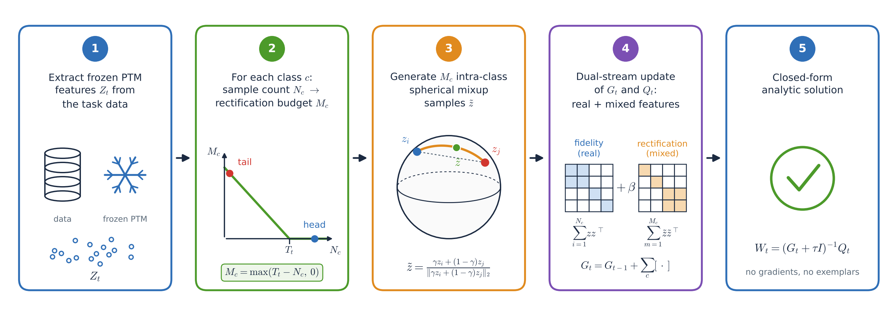

# Spectral-Aware Analytic Class-Incremental Learning for Long-Tailed Distributions

Official implementation of **Geometry-Spectral Rectification (GSR)**, ECCV 2026.

Quyen Tran*, Ngoc-Hai Nguyen*, Quan Dao, Zhuowei Li, Nam Le, Trung Le, Dimitris Metaxas



## Abstract

Analytic Continual Learning (ACL) offers a computationally efficient alternative to gradient-based
approaches. Recent ACL methods are based on Recursive Least Squares (RLS) and have achieved the
state-of-the-art results compared to other alternatives. However, they falter significantly in
Class-Incremental Learning scenarios characterized by Long-Tailed distributions. While the
ill-conditioning of the autocorrelation (Gram) matrix is a known limitation of RLS, we demonstrate
that class imbalance exacerbates this issue into a distinct spectral pathology: "tail" classes
suffer from severe spectral collapse, rendering their subspaces numerically indistinguishable from
noise. Standard Ridge Regression (L2) fails to address this effectively as it applies isotropic
regularization - a uniform penalty that is insufficient to stabilize the tail without
over-shrinking the head. To address this, we propose Geometry-Spectral Rectification (GSR), a
theoretically grounded framework that treats long-tailed learning as a spectral regularization
problem. Unlike standard isotropic regularization (Ridge) which uniformly penalizes all
eigenvalues, GSR acts as an anisotropic spectral filter, selectively inflating the collapsed
eigenvalues of tail classes. We construct a structured, data-dependent spectral perturbation
matrix ∆ that selectively inflates collapsed tail eigen-directions of the Gram matrix. Theoretical
analysis proves that GSR guarantees an improved stable rank for the Gram matrix, ensuring numerical
stability. Extensive experiments show that GSR establishes a new state-of-the-art for analytic CIL,
offering a superior trade-off between computational efficiency and robust generalization in
long-tailed settings.

## Setup

```bash
pip install -r requirements.txt
```

* **Backbones.** DINOv2 ViT-B/14 is downloaded from the Hugging Face hub (`facebook/dinov2-base`).
  For MoCo v3, download the ViT-B 300-epoch checkpoint from the
  [MoCo v3 repository](https://github.com/facebookresearch/moco-v3) and pass it with `--mocov3_ckpt`.
* **Datasets.** CIFAR-100 and ImageNet-R are downloaded automatically to `--data_dir`. CUB-200-2011
  and Tiny-ImageNet have to be extracted to `<data_dir>/CUB_200_2011` and
  `<data_dir>/tiny-imagenet-200`.

## Usage

```bash
# GACL + GSR on long-tailed Split-CUB-200 (30% head classes, 5-shot tail classes)
python run.py --dataset_name cub --model_name gacl_gsr --backbone dinov2 --seed 0

# plain GACL baseline
python run.py --dataset_name cub --model_name gacl --backbone dinov2 --seed 0
```

The backbone is frozen, so the features of each dataset are extracted once, cached in
`--feature_dir` and reused by every method and seed. Results (accuracy matrix, last / average
accuracy, head / tail accuracy) are written to
`logs/<dataset>/<backbone>/<experiment>/seed<k>/results.json`; `python tools/summarize.py`
aggregates them over seeds.

### Methods (`--model_name`)

| name | method |
|---|---|
| `gacl`, `gacl_gsr` | RLS classifier on a random-projection buffer layer, without / with GSR |
| `ranpac`, `ranpac_gsr` | RanPAC classifier (frozen backbone, random projection + ridge), without / with GSR |
| `anacp`, `anacp_gsr` | AnaCP, without / with GSR |
| `air` | Analytic Imbalance Rectifier |
| `slda`, `klda`, `fecam`, `ncm` | SLDA, KLDA, FeCAM, SimpleCIL (nearest class mean) |

### Main options

| flag | default | meaning |
|---|---|---|
| `--scenario` | `long_tail` | `long_tail` or `standard` (balanced) class-incremental learning |
| `--head_ratio`, `--tail_shot` | `0.3`, `5` | fraction of head classes, training samples per tail class |
| `--n_tasks` | `10` | number of incremental tasks |
| `--D`, `--reg` | `5000`, `1e2` | random-projection dimension and ridge parameter |
| `--gsr_geometry` | `spherical` | `spherical`: mixed features are re-projected onto the unit sphere; `linear`: plain mixup |
| `--gsr_budget` | `balance` | mixed samples per class: `balance` gives `max(T − N_c, 0)` to a class with `N_c` real samples |
| `--gsr_max_target` | `200` | cap on `T`, the per-class count that classes are filled up to within a task |
| `--gsr_beta` | `1.0` | weight of the rectification term |
| `--gsr_alpha` | `2.0` | mixing coefficient `γ ~ Beta(α, α)` |
| `--gsr_sampler` | `mixup` | `mixup` is GSR; `inter_mixup`, `gauss_shrinkage`, `gauss_transfer` are the alternatives it is compared with |

`python run.py --help` lists all options.

### Experiments

```bash
bash scripts/main_longtail.sh dinov2     # all methods, all datasets, 3 seeds
bash scripts/main_longtail.sh mocov3
bash scripts/ablation.sh cub dinov2      # ablations of GSR on top of GACL
bash scripts/imbalance.sh                # imbalance ratio on Split-CIFAR-100
bash scripts/table6.sh dinov2            # GSR vs. Gaussian sampling and inter-class mixup
python tools/plot_stable_rank.py --per_task --families gacl   # stable-rank figure (per task)
python tools/plot_stable_rank.py --families gacl              # stable-rank figure (accumulated)
python tools/summarize.py --log_dir ./logs
```

`tools/sweep_gsr.py` selects hyper-parameters on a validation set held out from the training
images (see `scripts/sweep.sh`); the test set is never used for selection. AnaCP + GSR has three
hyper-parameters of its own (rectification weight, logit re-weighting exponent, tail over-sampling
factor); the values selected for each backbone and dataset are listed in `models/anacp_gsr.py` and
used by default, `scripts/sweep_anacp.sh` re-runs the selection, and `--anacp_hparams default`
switches to the un-tuned configuration. All other methods use the shared defaults
(`--D 5000 --reg 1e2`). `python -m pytest tests` runs sanity checks on synthetic features.

## Citation

```bibtex
@inproceedings{tran2026spectral,
  title={Spectral-aware analytic class-incremental learning for long-tailed distributions},
  author={Tran, Quyen and Nguyen, Hai and Dao, Quan and Li, Zhuowei and Le, Nam and Le, Trung and Metaxas, Dimitris},
  booktitle={European Conference on Computer Vision},
  pages={448--465},
  year={2026},
  organization={Springer}
}
```

## License

Released under the [MIT License](LICENSE).
